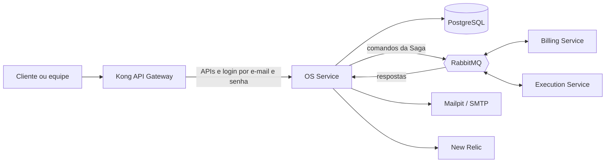

# OS Service

Microsserviço de ordens de serviço da oficina mecânica (Tech Challenge — Fase 4). É o monólito das fases anteriores, reduzido: gerencia a abertura, o status e o histórico das ordens de serviço (OS), mantém os cadastros de clientes, veículos, catálogo de serviços e estoque, e **orquestra a Saga** que coordena a OS com os serviços de Billing e de Execution.

O que saiu deste serviço na Fase 4: orçamento, aprovação e pagamento foram para o Billing Service; diagnóstico e execução do reparo foram para o Execution Service.

## Visão do serviço



O Kong é o ponto de entrada das rotas expostas. O login `POST /api/auth/login` do OS Service usa e-mail e senha e emite o JWT. A API aplica autenticação JWT e autorização por perfil. O JWT leva o papel do usuário no claim `role`, porque os outros serviços não têm tabela de usuários. Não há Lambda de login por CPF no deploy da Fase 4. Mudanças de status da OS geram notificações assíncronas por e-mail; logs, health checks, eventos de negócio e cada passo da Saga são enviados ao New Relic quando configurado.

## Saga da ordem de serviço

Detalhes, diagramas de sequência e catálogo de mensagens em [docs/architecture/saga.md](docs/architecture/saga.md). Arquitetura geral (C4) em [docs/architecture/c4-model.md](docs/architecture/c4-model.md) e implantação na AWS em [docs/architecture/component-diagram.md](docs/architecture/component-diagram.md).

**Estratégia: orquestrada**, com o orquestrador neste serviço (`application/saga/ServiceOrderSagaOrchestrator`).

Por que orquestração e não coreografia:

- O fluxo é linear, com ordem fixa, e as compensações acontecem em ordem inversa. Um orquestrador expressa isso como uma máquina de estados em um único lugar.
- O estado da Saga é persistido (`saga_instances`, `saga_log`) e consultável em `GET /api/service-orders/{id}/saga`: dá para ver em que passo cada OS está e por que falhou.
- Na coreografia, a lógica de compensação ficaria espalhada pelos três serviços e os ciclos de eventos seriam difíceis de depurar.
- O custo é o orquestrador conhecer os contratos dos participantes. É aceitável aqui porque a OS já é o agregado central do negócio.

Fluxo: abrir OS → diagnóstico (Execution) → precificação (local) → orçamento (Billing) → aprovação do cliente (Billing) → reserva de estoque (local) → pagamento (Billing) → reparo (Execution) → entrega (local).

| Falha | Compensação | Saga |
|---|---|---|
| Diagnóstico com serviço ou peça inexistente | Devolve o diagnóstico ao mecânico | continua |
| Cliente recusa o orçamento | Cancela a ordem de trabalho | `CANCELED` |
| Passo expira (Billing não responde, cliente não aprova ou não paga) | Devolve o estoque, se reservado → cancela o orçamento → cancela a ordem de trabalho | `COMPENSATED` |
| Pagamento recusado | Devolve o estoque → cancela o orçamento → cancela a ordem de trabalho | `COMPENSATED` |
| Reparo inviável | Estorna o pagamento → devolve o estoque → cancela o orçamento | `COMPENSATING` → `COMPENSATED` |

Garantias: comandos gravados em outbox na mesma transação da mudança de estado; consumidor idempotente; respostas atrasadas ou fora de ordem ignoradas pelo passo atual da Saga; dead-letter queue; prazo por passo (`SAGA_BUDGET_GENERATION_TIMEOUT`, `SAGA_APPROVAL_TIMEOUT`, `SAGA_PAYMENT_TIMEOUT`).

## Tecnologias

- Java 21, Spring Boot 4, Spring Security, JWT e Spring Data JPA/Hibernate;
- RabbitMQ (Spring AMQP) para os comandos e respostas da Saga;
- PostgreSQL 17 no ambiente local e PostgreSQL RDS no ambiente gerenciado;
- Docker, Docker Compose e Kubernetes;
- Kong, Mailpit, OpenAPI/Swagger e New Relic.

## Pré-requisitos

Para executar localmente: Docker Desktop com Docker Compose. Para executar sem containers: JDK 21 e Maven. O arquivo `.env` contém as variáveis usadas pelo Compose; não publique chaves, senhas ou tokens reais.

## Execução local com Docker

```bash
docker compose up --build
```

Este Compose sobe só este serviço e suas dependências (PostgreSQL, RabbitMQ, Mailpit, Kong). Uma OS aberta assim fica parada em `RECEIVED`, porque ninguém consome os comandos da Saga. Para o fluxo completo, use o ambiente completo descrito abaixo.

| Serviço | Endereço |
|---|---|
| Gateway Kong (entrada da API) | `http://localhost:8000` |
| Swagger da aplicação | `http://localhost:8080/swagger-ui.html` |
| Health check | `http://localhost:8080/actuator/health` |
| Mailpit | `http://localhost:8025` |
| RabbitMQ | `http://localhost:15672` (guest/guest) |
| pgAdmin | `http://localhost:5050` |

Pare o ambiente com `docker compose down`. Para remover também o volume local do PostgreSQL, use `docker compose down -v` (isso apaga os dados locais).

## Ambiente completo (três serviços)

Com os três repositórios clonados lado a lado (`mechanic-shop-os-service`, `mechanic-shop-billing-service`, `mechanic-shop-execution-service`), rode na raiz deste repositório:

```bash
docker compose -f docker-compose.full.yaml up --build -d
./scripts/saga_e2e.sh happy            # OS aberta e entregue pela Saga, tudo via Kong
./scripts/saga_e2e.sh payment_refused  # também: budget_rejected, repair_failed
docker compose -f docker-compose.full.yaml down -v
```

Sobe o OS Service (PostgreSQL), o Billing Service (PostgreSQL próprio), o Execution Service (MongoDB em replica set), o RabbitMQ, o Mailpit e o Kong, que passa a ser a entrada única em `http://localhost:8000`. As portas publicadas podem ser trocadas por variável (`KONG_PORT`, `OS_PORT`, `BILLING_PORT`, `EXECUTION_PORT`, `RABBITMQ_UI_PORT`, `MAILPIT_UI_PORT`) se já estiverem em uso. O script `saga_e2e.sh` imprime cada `curl` e confere o efeito nos três serviços; os testes de carga estão em [k6/](k6/README.md).

## Execução sem Docker

Inicie um PostgreSQL e um RabbitMQ acessíveis e informe `SPRING_DATASOURCE_URL`, `SPRING_DATASOURCE_USERNAME`, `SPRING_DATASOURCE_PASSWORD` e, se o broker não estiver em `localhost:5672`, `RABBITMQ_HOST` e `RABBITMQ_PORT`. Em seguida:

```bash
./mvnw test
./mvnw spring-boot:run
```

No Windows, substitua `./mvnw` por `./mvnw.cmd`. Para gerar o pacote, execute `./mvnw package`.

## Uso da API

A documentação interativa está em [Swagger local](http://localhost:8080/swagger-ui.html). Primeiro obtenha um JWT em `POST /api/auth/login`; envie-o como `Authorization: Bearer <token>` nas rotas protegidas. A OS segue o fluxo `RECEIVED` → `DIAGNOSIS` → `PENDING_APPROVAL` → `PENDING_PAYMENT` → `IN_PROGRESS` → `COMPLETED` → `DELIVERED`, e termina `CANCELED` quando o orçamento é recusado ou a Saga é compensada. Este serviço abre a OS (`POST /api/service-orders/create`) e entrega o veículo (`POST /api/service-orders/{id}/deliver`); os demais avanços de status são feitos pela Saga, a partir das ações registradas no Execution Service (diagnóstico e reparo) e no Billing Service (aprovação e pagamento).

As rotas de cliente são adicionalmente protegidas pelo Kong. O login usa `POST /api/auth/login` no gateway, com corpo `{"email":"usuario@exemplo.com","password":"senha"}`. Billing e Execution validam o JWT emitido pelo OS Service usando o mesmo `JWT_SECRET`.

## Testes

```bash
./mvnw verify      # os testes de integração precisam de Docker (Testcontainers)
```

- Testes unitários e de integração (PostgreSQL real) das fases anteriores, atualizados.
- BDD em `src/test/resources/features/saga_ordem_de_servico.feature`: 6 cenários da Saga (fluxo completo, recusa, pagamento recusado, reparo inviável, prazo expirado e entrega duplicada).
- O build falha se a cobertura de linhas, somando unitários e integração, ficar abaixo de 80%.

### Evidência de cobertura

Medição de 09/11/2026 (`./mvnw verify`, todos os testes passando):

| Testes | Linhas | Condições | Cobertura no SonarCloud (linhas + condições) |
|---|---|---|---|
| 224 unitários + 27 de integração | 88,2% | 75,3% | **85,8%** |

- Relatório JaCoCo local: `target/site/jacoco-merged/index.html` (unitários + integração).
- No CI, todo PR e todo push publica o relatório como artefato `coverage-report` do workflow e envia a cobertura ao SonarCloud, cujo quality gate precisa passar: [painel do projeto](https://sonarcloud.io/summary/overall?id=EddieMarley23_mechanic-shop-os-service).

## Implantação

O workflow `.github/workflows/ci-cd.yml` valida `terraform/` e roda `./mvnw verify` (unitários, integração, BDD e gate de 80%) em todo PR para `master`, publica o relatório de cobertura como artefato e, se o secret `SONAR_TOKEN` existir, faz a análise no SonarQube/SonarCloud com quality gate. No push para `master`, verifica credenciais AWS, cria ou reutiliza o state S3, provisiona EKS e RDS OS com Terraform, publica a imagem no Docker Hub e aplica `k8s/` no EKS. A configuração completa, incluindo **todos os secrets e variables de cada repositório**, está em [terraform/README.md](terraform/README.md).

Este repositório é o único dono da infraestrutura compartilhada no namespace `mechanic-shop`: **cluster EKS**, RabbitMQ (broker e exchanges da Saga), Kong, Mailpit e metrics-server. O OS declara sua fila de respostas; Billing e Execution declaram somente as respectivas filas. No primeiro deploy, rode este pipeline antes dos pipelines do Billing e do Execution. O banco RDS do OS também é provisionado aqui; os outros bancos pertencem aos próprios serviços.

O Kong (`kong/kong.yml` local e `k8s/01-config/13-kong-config.yaml` no cluster) roteia `/api/billing/**` para o Billing Service e `/api/executions/**` para o Execution Service; o resto de `/api` continua vindo para este serviço. As rotas do cliente no Billing (orçamento e pagamento da OS) exigem JWT no gateway; o link de aprovação do e-mail e o webhook do Mercado Pago são públicos.

| GitHub | Nome |
|---|---|
| Secrets | `AWS_ACCESS_KEY_ID`, `AWS_SECRET_ACCESS_KEY`, `AWS_SESSION_TOKEN`, `DOCKERHUB_TOKEN`, `JWT_SECRET`, `DATABASE_PASSWORD`, `SEED_DEFAULT_PASSWORD`, `RABBITMQ_USERNAME`, `RABBITMQ_PASSWORD`; `INTERNAL_API_SECRET`, `NEW_RELIC_LICENSE_KEY`, `SONAR_TOKEN` opcionais |
| Variables | `DOCKERHUB_USERNAME`; opcionais: `AWS_REGION`, `EKS_CLUSTER_NAME`, `EKS_CLUSTER_ROLE_NAME`, `EKS_NODE_ROLE_NAME`, `APP_BASE_URL`, `NEW_RELIC_APP_NAME`, `SONAR_PROJECT_KEY`, `SONAR_ORGANIZATION`, `SONAR_HOST_URL` |

`JWT_SECRET` e `RABBITMQ_USERNAME`/`RABBITMQ_PASSWORD` precisam ter o mesmo valor nos três repositórios.

Banco existente: o status `PENDING_PAYMENT` é novo. Se a tabela `service_orders` foi criada pelo Hibernate antes desta versão, a restrição de valores da coluna `status` precisa ser removida ou recriada; o `ddl-auto: update` não faz isso.

## Repositórios relacionados

- Billing Service: orçamento, aprovação e pagamento;
- Execution Service: fila de execução, diagnóstico e reparo;
- Os repositórios das fases anteriores são históricos; a infraestrutura da Fase 4 está nos três repositórios atuais.
