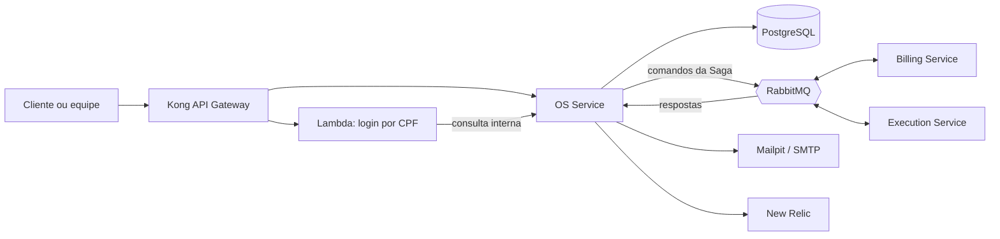

# OS Service

Microsserviço de ordens de serviço da oficina mecânica (Tech Challenge — Fase 4). É o monólito das fases anteriores, reduzido: gerencia a abertura, o status e o histórico das ordens de serviço (OS), mantém os cadastros de clientes, veículos, catálogo de serviços e estoque, e **orquestra a Saga** que coordena a OS com os serviços de Billing e de Execution.

O que saiu deste serviço na Fase 4: orçamento, aprovação e pagamento foram para o Billing Service; diagnóstico e execução do reparo foram para o Execution Service.

## Visão do serviço



O Kong é o ponto de entrada das rotas expostas. A API aplica autenticação JWT e autorização por perfil. O JWT leva o papel do usuário no claim `role`, porque os outros serviços não têm tabela de usuários. O login por CPF é atendido pela Lambda do repositório específico. Mudanças de status da OS geram notificações assíncronas por e-mail; logs, health checks, eventos de negócio e cada passo da Saga são enviados ao New Relic quando configurado.

## Saga da ordem de serviço

**Estratégia: orquestrada**, com o orquestrador neste serviço (`application/saga/ServiceOrderSagaOrchestrator`).

Por que orquestração e não coreografia:

- O fluxo é linear, com ordem fixa, e as compensações acontecem em ordem inversa. Um orquestrador expressa isso como uma máquina de estados em um único lugar.
- O estado da Saga é persistido (`saga_instances`, `saga_log`) e consultável em `GET /api/service-orders/{id}/saga`: dá para ver em que passo cada OS está e por que falhou.
- Na coreografia, a lógica de compensação ficaria espalhada pelos três serviços e os ciclos de eventos seriam difíceis de depurar.
- O custo é o orquestrador conhecer os contratos dos participantes. É aceitável aqui porque a OS já é o agregado central do negócio.

Fluxo: abrir OS → diagnóstico (Execution) → precificação (local) → orçamento (Billing) → aprovação do cliente (Billing) → reserva de estoque (local) → pagamento (Billing) → reparo (Execution) → entrega (local).

| Falha | Compensação | Saga |
|---|---|---|
| Diagnóstico com serviço ou peça inexistente | Devolve o diagnóstico ao mecânico | continua |
| Cliente recusa o orçamento | Cancela a ordem de trabalho | `CANCELED` |
| Passo expira (Billing não responde, cliente não aprova ou não paga) | Devolve o estoque, se reservado → cancela o orçamento → cancela a ordem de trabalho | `COMPENSATED` |
| Pagamento recusado | Devolve o estoque → cancela o orçamento → cancela a ordem de trabalho | `COMPENSATED` |
| Reparo inviável | Estorna o pagamento → devolve o estoque → cancela o orçamento | `COMPENSATING` → `COMPENSATED` |

Garantias: comandos gravados em outbox na mesma transação da mudança de estado; consumidor idempotente; respostas atrasadas ou fora de ordem ignoradas pelo passo atual da Saga; dead-letter queue; prazo por passo (`SAGA_BUDGET_GENERATION_TIMEOUT`, `SAGA_APPROVAL_TIMEOUT`, `SAGA_PAYMENT_TIMEOUT`).

## Tecnologias

- Java 21, Spring Boot 4, Spring Security, JWT e Spring Data JPA/Hibernate;
- RabbitMQ (Spring AMQP) para os comandos e respostas da Saga;
- PostgreSQL 17 no ambiente local e PostgreSQL RDS no ambiente gerenciado;
- Docker, Docker Compose e Kubernetes;
- Kong, Mailpit, OpenAPI/Swagger e New Relic.

## Pré-requisitos

Para executar localmente: Docker Desktop com Docker Compose. Para executar sem containers: JDK 21 e Maven. O arquivo `.env` contém as variáveis usadas pelo Compose; não publique chaves, senhas ou tokens reais.

## Execução local com Docker

```bash
docker compose up --build
```

Este Compose sobe só este serviço e suas dependências (PostgreSQL, RabbitMQ, Mailpit, Kong). Uma OS aberta assim fica parada em `RECEIVED`, porque ninguém consome os comandos da Saga. Para o fluxo completo, suba os três serviços com o Compose da pasta que os reúne.

| Serviço | Endereço |
|---|---|
| Gateway Kong (entrada da API) | `http://localhost:8000` |
| Swagger da aplicação | `http://localhost:8080/swagger-ui.html` |
| Health check | `http://localhost:8080/actuator/health` |
| Mailpit | `http://localhost:8025` |
| RabbitMQ | `http://localhost:15672` (guest/guest) |
| pgAdmin | `http://localhost:5050` |

Pare o ambiente com `docker compose down`. Para remover também o volume local do PostgreSQL, use `docker compose down -v` (isso apaga os dados locais).

## Execução sem Docker

Inicie um PostgreSQL e um RabbitMQ acessíveis e informe `SPRING_DATASOURCE_URL`, `SPRING_DATASOURCE_USERNAME`, `SPRING_DATASOURCE_PASSWORD` e, se o broker não estiver em `localhost:5672`, `RABBITMQ_HOST` e `RABBITMQ_PORT`. Em seguida:

```bash
./mvnw test
./mvnw spring-boot:run
```

No Windows, substitua `./mvnw` por `./mvnw.cmd`. Para gerar o pacote, execute `./mvnw package`.

## Uso da API

A documentação interativa está em [Swagger local](http://localhost:8080/swagger-ui.html). Primeiro obtenha um JWT em `POST /api/auth/login`; envie-o como `Authorization: Bearer <token>` nas rotas protegidas. A OS segue o fluxo `RECEIVED` → `DIAGNOSIS` → `PENDING_APPROVAL` → `PENDING_PAYMENT` → `IN_PROGRESS` → `COMPLETED` → `DELIVERED`, e termina `CANCELED` quando o orçamento é recusado ou a Saga é compensada. Este serviço abre a OS (`POST /api/service-orders/create`) e entrega o veículo (`POST /api/service-orders/{id}/deliver`); os demais avanços de status são feitos pela Saga, a partir das ações registradas no Execution Service (diagnóstico e reparo) e no Billing Service (aprovação e pagamento).

As rotas de cliente são adicionalmente protegidas pelo Kong. O login por CPF é `POST /functions/cpf-login` no gateway, com corpo `{"document":"CPF_SEM_MASCARA"}`. Para usá-lo localmente, a Lambda e sua integração com o Kong devem estar previamente implantadas; o Compose desta aplicação não cria recursos AWS.

## Testes

```bash
./mvnw verify      # os testes de integração precisam de Docker (Testcontainers)
```

- Testes unitários e de integração (PostgreSQL real) das fases anteriores, atualizados.
- BDD em `src/test/resources/features/saga_ordem_de_servico.feature`: 6 cenários da Saga (fluxo completo, recusa, pagamento recusado, reparo inviável, prazo expirado e entrega duplicada).
- O build falha se a cobertura de linhas, somando unitários e integração, ficar abaixo de 80%. Medição em 10/10/2026: **186 testes unitários + 27 de integração, 84,7% de linhas** (`target/site/jacoco-merged/index.html`).

## Implantação

Os manifests em `k8s/` e o workflow em `.github/workflows/` ainda são os da Fase 3: não incluem o RabbitMQ nem as variáveis da Saga, e a configuração do Kong em `k8s/01-config/13-kong-config.yaml` ainda aponta a rota de aprovação de orçamento para este serviço. A atualização do deploy faz parte da próxima etapa.

Os testes de carga em `k6/` também são da Fase 3 e chamam endpoints que migraram para os outros serviços (`quote`, `request-approval`, `budget-response`, `finish`).

Banco existente: o status `PENDING_PAYMENT` é novo. Se a tabela `service_orders` foi criada pelo Hibernate antes desta versão, a restrição de valores da coluna `status` precisa ser removida ou recriada; o `ddl-auto: update` não faz isso.

## Repositórios relacionados

- Billing Service: orçamento, aprovação e pagamento;
- Execution Service: fila de execução, diagnóstico e reparo;
- `mechanic-shop-pos-tech-challenger-lambda`: autenticação por CPF;
- `mechanic-shop-pos-tech-challenger-kubernetes`: VPC, EKS, Lambda de infraestrutura e observabilidade;
- `mechanic-shop-pos-tech-challenger-managed-database`: PostgreSQL RDS privado.
