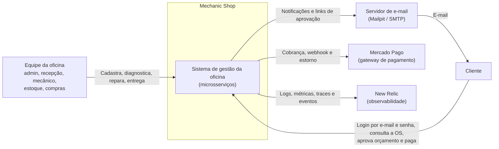
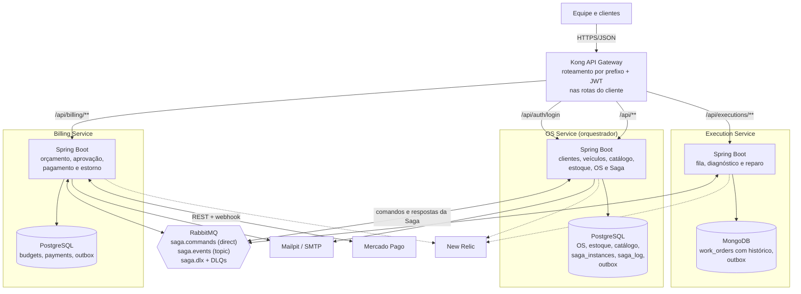
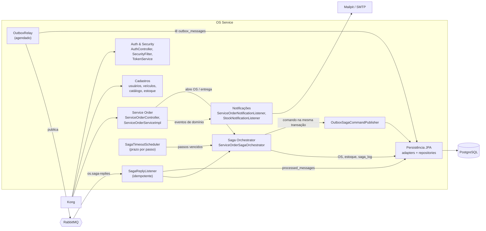
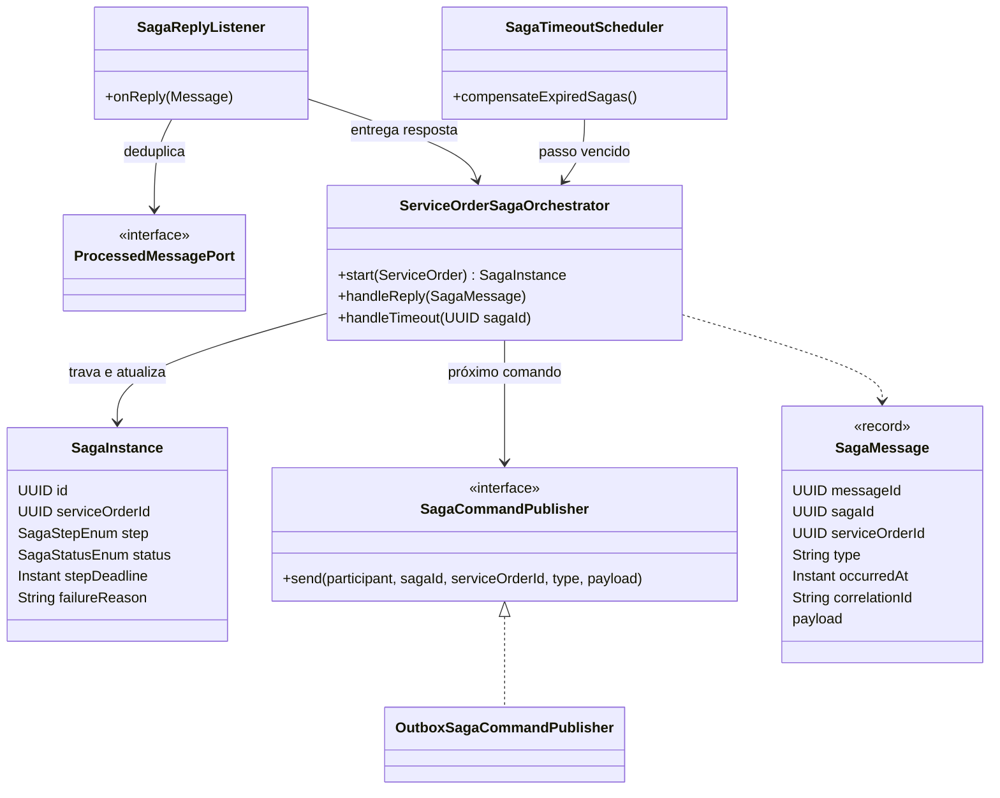

# C4 Model - Mechanic Shop (Fase 4)

Este documento descreve a arquitetura distribuída da oficina mecânica nos níveis do C4 Model. A fonte é a implementação real dos três repositórios. Os detalhes da Saga estão em [saga.md](saga.md), e a implantação na AWS em [component-diagram.md](component-diagram.md).

## Escopo

- **Domínio:** gestão de clientes, veículos, catálogo de serviços, estoque e o ciclo de vida da ordem de serviço (OS), do diagnóstico ao pagamento e à entrega.
- **Estilo arquitetural:** três microsserviços Spring Boot independentes, cada um com repositório, pipeline, imagem e banco próprios, atrás de um API Gateway (Kong).
- **Consistência:** Saga **orquestrada** pelo OS Service, com comandos e respostas via RabbitMQ, outbox transacional e compensações.
- **Preocupações transversais:** JWT único para os três serviços (claim `role`), RBAC em cada serviço, observabilidade no New Relic com `correlationId` propagado nas mensagens.

## C1 - System Context

O Billing Service integra o Mercado Pago (Checkout Pro) por trás da porta `PaymentGateway`; o adapter `simulated` continua disponível para desenvolvimento e testes de carga.

## C2 - Containers

### Containers

| Container | Tecnologia | Responsabilidade | Dados |
|---|---|---|---|
| Kong | Kong 3.7 (DB-less) | Entrada única. Roteia por prefixo e valida o JWT nas rotas do cliente | — |
| **OS Service** | Java 21, Spring Boot 4, JPA | Cadastros, abertura/status/histórico da OS, estoque e preços. **Orquestra a Saga** | PostgreSQL |
| **Billing Service** | Java 21, Spring Boot 4, JPA | Orçamento, aprovação do cliente, cobrança, verificação de pagamento e estorno | PostgreSQL próprio |
| **Execution Service** | Java 21, Spring Boot 4, Spring Data MongoDB | Fila de execução, diagnóstico, reparo e finalização | MongoDB (replica set) |
| RabbitMQ | RabbitMQ 4 | Transporte dos comandos e respostas da Saga, com dead-letter | — |
| Mailpit / SMTP | Mailpit (local/cluster) | Notificações e links de aprovação | — |
| New Relic | Agente Java + Insights | APM, logs estruturados, traces distribuídos, eventos de negócio | — |

### Por que esta divisão

- **OS Service** concentra o agregado central (a OS) e os dados que precificam o orçamento (catálogo e estoque). Por isso é o orquestrador: ele já conhece o estado da OS e é quem decide o próximo passo.
- **Billing Service** isola dinheiro: orçamento, cobrança e estorno mudam por motivos diferentes (provedor de pagamento, regras fiscais) e têm requisitos próprios de auditoria e idempotência.
- **Execution Service** isola o chão de oficina: a fila e o histórico do reparo crescem rápido, não têm junções e se encaixam bem em documentos (MongoDB).
- **SQL e NoSQL:** PostgreSQL onde há relacionamentos e transações sobre valores (OS, estoque, pagamentos); MongoDB onde cada ordem de trabalho é um documento autocontido com histórico embutido.

### Comunicação

| De → Para | Estilo | Quando |
|---|---|---|
| Cliente/equipe → serviços | REST síncrono via Kong | Ações de usuário (abrir OS, diagnosticar, aprovar, pagar, entregar) |
| Kong → OS Service | REST síncrono (`POST /api/auth/login`) | Login por e-mail e senha |
| OS → Billing / Execution | **Comando assíncrono** (`saga.commands`, routing key `billing` / `execution`) | Cada passo da Saga |
| Billing / Execution → OS | **Resposta assíncrona** (`saga.events`, fila `os.saga-replies`) | Resultado de cada passo |
| Billing ↔ Mercado Pago | REST síncrono (preferência, consulta, estorno) + webhook assinado | Cobrança, confirmação e estorno |

**Nenhum serviço lê o banco de outro.** O Billing recebe tudo o que precisa sobre a OS no comando `billing.budget.generate` (cliente, placa, itens já precificados); o Execution recebe os dados do veículo e da reclamação no `execution.diagnosis.start`.

## C3 - Componentes do OS Service

| Componente | Classes | Responsabilidade |
|---|---|---|
| Auth & Security | `AuthController`, `SecurityFilter`, `TokenService` | Login, emissão e validação do JWT, RBAC por `@PreAuthorize` |
| Cadastros | controllers, services, validators e mappers de usuários, veículos, serviços e estoque | Dados mestres usados para precificar o orçamento |
| Service Order | `ServiceOrderController`, `ServiceOrderServiceImpl` | Abre e entrega a OS; consulta status, histórico e o estado da Saga (`GET /api/service-orders/{id}/saga`) |
| Saga Orchestrator | `ServiceOrderSagaOrchestrator` | Máquina de estados da Saga: decide o próximo comando, aplica compensações e muda o status da OS |
| Outbox | `OutboxSagaCommandPublisher`, `OutboxRelay` | Grava o comando na mesma transação da mudança de estado e publica depois, garantindo *at-least-once* |
| Reply listener | `SagaReplyListener` | Consome respostas, descarta duplicadas (`processed_messages`) e propaga o `correlationId` |
| Timeout scheduler | `SagaTimeoutScheduler` | Compensa passos sem resposta no prazo (`app.saga.*-timeout`) |
| Notificações | `ServiceOrderNotificationListener`, `StockNotificationListener` | E-mails assíncronos após o commit |

## C4 - Código do Saga Orchestrator

### Regras do orquestrador

- Uma resposta = uma transação local: trava a linha da Saga, confere se o passo atual espera aquela resposta, muda a OS e grava o próximo comando na outbox.
- Respostas atrasadas, duplicadas ou para outro passo são ignoradas.
- O contrato (`SagaMessage`, nomes dos tipos e payloads) está replicado nos três serviços e deve mudar nos três juntos.

## Observações arquiteturais

- **Consistência eventual:** entre um comando e sua resposta a OS fica em estado intermediário. O endpoint de status da Saga mostra o passo e o motivo de falha.
- **Entrega *at-least-once*:** outbox + consumidores idempotentes. Mensagens que falham repetidamente vão para a DLQ da fila (`*.dlq`), sem bloquear a fila principal.
- **Isolamento de falha:** se o Billing ou o Execution cair, os comandos ficam na fila. Se o RabbitMQ cair, ficam na outbox de cada serviço. Os prazos da Saga evitam que uma OS fique parada para sempre.
- **Observabilidade:** cada transição da Saga gera o evento `MechanicShopSagaTransition` no New Relic, e falhas geram `MechanicShopSagaFailure`. O `correlationId` viaja nas mensagens, o que liga os logs dos três serviços para a mesma OS.
