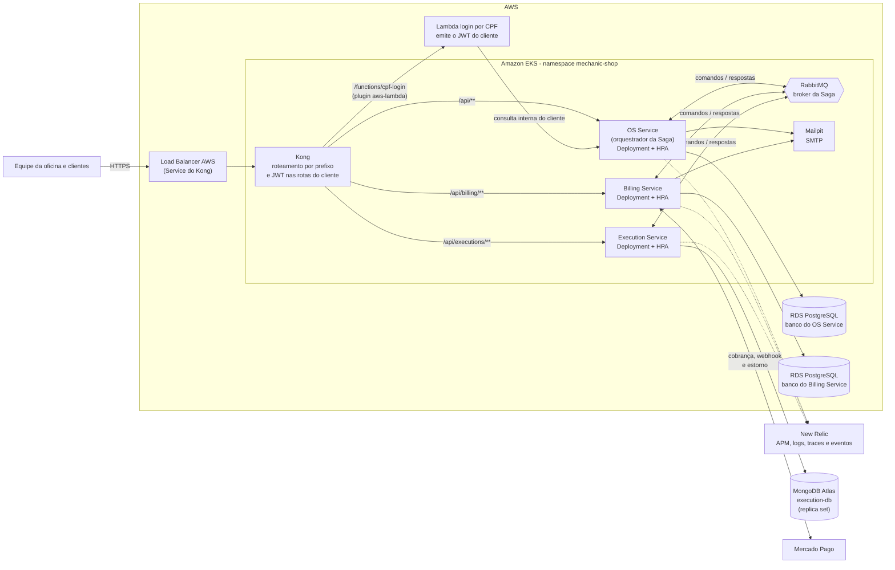

# Diagrama de Implantação na AWS (Fase 4)

Visão de implantação dos três microsserviços no EKS. A visão lógica (C4) está em [c4-model.md](c4-model.md), e o fluxo da Saga em [saga.md](saga.md).

## Leitura do diagrama

- **Uma entrada pública:** o Load Balancer da AWS é criado pelo `Service` do Kong (`type: LoadBalancer`). Os Services dos três microsserviços são `ClusterIP`, então nenhuma requisição externa contorna o gateway.
- **Roteamento:** o Kong escolhe o serviço pelo prefixo mais longo. As rotas do cliente (status e detalhe da OS, veículos, orçamento e pagamento) exigem JWT no próprio Kong, além do RBAC de cada serviço. O link de aprovação do e-mail e o webhook do Mercado Pago são públicos e protegidos por token de uso único e por assinatura, respectivamente.
- **Login por CPF:** o Kong invoca a Lambda diretamente pelo plugin `aws-lambda`. A Lambda consulta o OS Service pela rota interna (`/internal`, com `X-Internal-Secret`) e emite o mesmo JWT que os três serviços validam.
- **Um banco por serviço:** o OS e o Billing usam bancos PostgreSQL separados, e o Execution usa MongoDB. Nenhum serviço tem credenciais do banco de outro.
- **Broker compartilhado, filas próprias:** o RabbitMQ é a única peça de infraestrutura compartilhada entre os serviços; cada serviço consome apenas a sua fila (`billing.commands`, `execution.commands`, `os.saga-replies`).
- **Observabilidade:** o agente New Relic roda nos três pods, com logs JSON (ECS), traces distribuídos, metadados Kubernetes e eventos de negócio (`MechanicShopSagaTransition`, `MechanicShopSagaFailure`). O `correlationId` atravessa as mensagens da Saga.

## Quem implanta o quê

Cada repositório tem seu pipeline (`.github/workflows/ci-cd.yml`) e seus manifestos (`k8s/`), aplicados no mesmo namespace:

| Repositório | Recursos no cluster | Recursos externos |
|---|---|---|
| `mechanic-shop-os-service` | OS Service (Deployment, Service, HPA), **RabbitMQ**, **Kong**, **Mailpit**, metrics-server | RDS do OS (repositório `managed-database`) |
| `mechanic-shop-billing-service` | Billing Service (Deployment, Service, HPA) | RDS do Billing, Mercado Pago |
| `mechanic-shop-execution-service` | Execution Service (Deployment, Service, HPA) | MongoDB Atlas |
| `mechanic-shop-pos-tech-challenger-kubernetes` | — | VPC, EKS, Lambda, New Relic (Terraform) |

Em um cluster novo, rode primeiro o pipeline do OS Service, que sobe o broker e o gateway usados pelos outros dois.

## Detalhes de implantação

- ConfigMaps guardam configuração não sigilosa (host do RabbitMQ, issuer do JWT, URLs, rótulos do New Relic). Os Secrets são criados pelo pipeline a partir dos secrets do GitHub (credenciais dos bancos e do broker, `JWT_SECRET`, chaves do Mercado Pago e do New Relic).
- Probes usam o Actuator: `readiness` inclui o banco do serviço, mas não o RabbitMQ. Se o broker cair, a outbox segura as mensagens e o pod continua atendendo.
- O HPA de cada serviço escala por CPU; o metrics-server é instalado pelo pipeline do OS.
- O RabbitMQ roda com uma réplica e volume efêmero. Para produção, use um StatefulSet com volume persistente ou o Amazon MQ.
