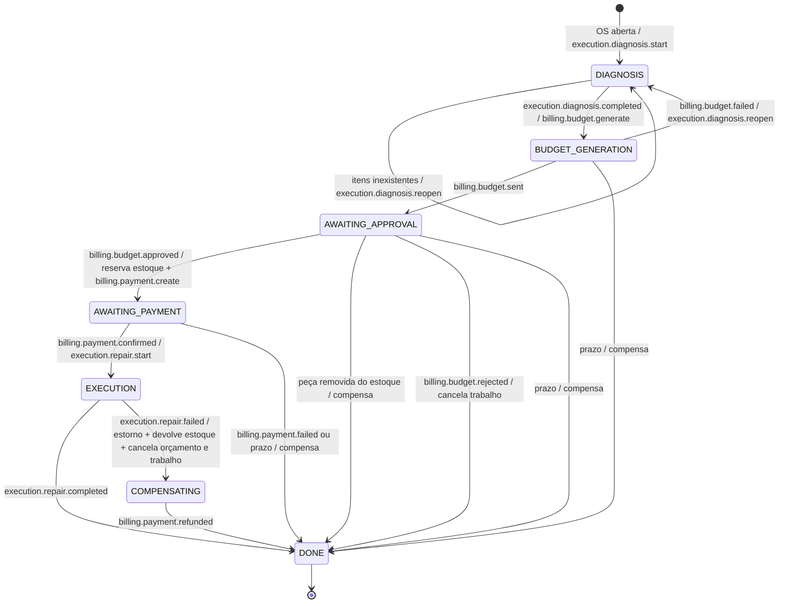
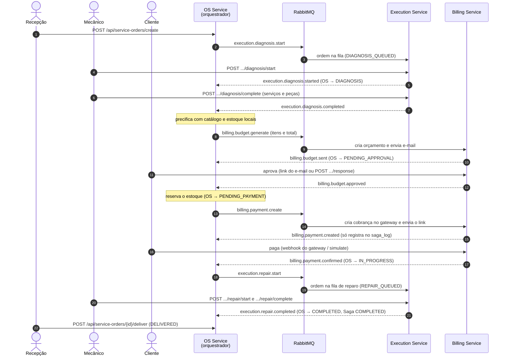
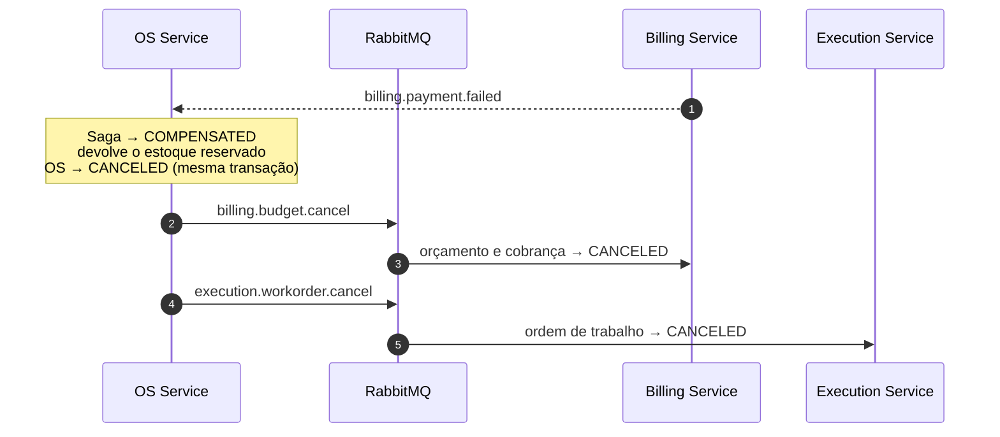
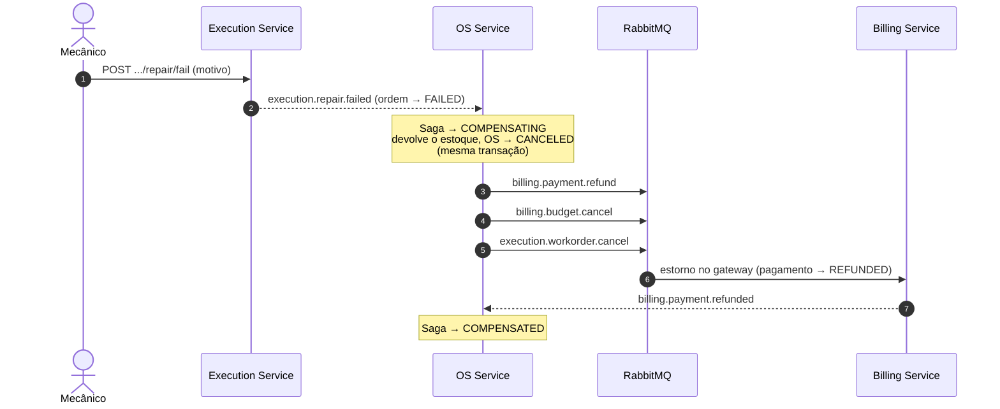
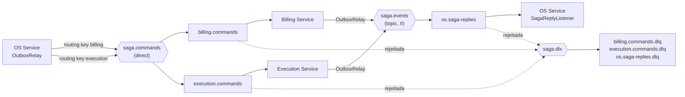

# Saga da Ordem de Serviço

A abertura, a aprovação, o pagamento e a execução de uma OS envolvem três serviços com bancos separados. Não existe transação distribuída: cada passo é uma transação local, e a consistência vem de uma **Saga orquestrada**. O orquestrador é o `ServiceOrderSagaOrchestrator`, no OS Service.

## Estratégia: orquestração

| Critério | Orquestração (escolhida) | Coreografia |
|---|---|---|
| Fluxo linear com ordem fixa | Um único lugar define a sequência | A sequência fica implícita na troca de eventos |
| Compensação em ordem inversa | Explícita no orquestrador | Espalhada pelos três serviços |
| Visibilidade | Estado persistido em `saga_instances`/`saga_log` e exposto em `GET /api/service-orders/{id}/saga` | Exige reconstruir o fluxo a partir de logs |
| Acoplamento | O orquestrador conhece os contratos dos participantes | Participantes conhecem os eventos uns dos outros |

O custo da orquestração é o OS Service conhecer os comandos do Billing e do Execution. Ele é aceitável porque a OS já é o agregado central do negócio. Os participantes não conhecem uns aos outros: só respondem ao orquestrador.

## Máquina de estados



Status da Saga (`SagaStatusEnum`): `RUNNING` → `COMPLETED`, ou `CANCELED` (recusa do cliente), ou `COMPENSATING` → `COMPENSATED`.

Correspondência com os status de cada serviço:

| Passo da Saga | OS (OS Service) | Ordem de trabalho (Execution) | Orçamento / pagamento (Billing) |
|---|---|---|---|
| `DIAGNOSIS` | `RECEIVED` → `DIAGNOSIS` | `DIAGNOSIS_QUEUED` → `IN_DIAGNOSIS` | — |
| `BUDGET_GENERATION` | `DIAGNOSIS` | `AWAITING_APPROVAL` | — |
| `AWAITING_APPROVAL` | `PENDING_APPROVAL` | `AWAITING_APPROVAL` | orçamento `SENT` |
| `AWAITING_PAYMENT` | `PENDING_PAYMENT` (já no `budget.approved`) | `AWAITING_APPROVAL` | orçamento `APPROVED`, pagamento `PENDING` |
| `EXECUTION` | `IN_PROGRESS` | `REPAIR_QUEUED` → `IN_REPAIR` | pagamento `CONFIRMED` |
| `DONE` (sucesso) | `COMPLETED` → `DELIVERED` | `COMPLETED` | — |
| `DONE` (compensada) | `CANCELED` | `CANCELED` / `FAILED` | orçamento `CANCELED`/`REJECTED`, pagamento `CANCELED`/`FAILED`/`REFUNDED` |

## Fluxo completo



As setas tracejadas são respostas publicadas em `saga.events` e consumidas pela fila `os.saga-replies`.

## Falhas e compensações

| Falha | Compensação (em ordem) | Resultado |
|---|---|---|
| Diagnóstico com serviço ou peça inexistente | `execution.diagnosis.reopen` (devolve ao mecânico com o motivo) | Saga continua em `DIAGNOSIS` |
| Billing recusa gerar o orçamento (`billing.budget.failed`: itens ou total inválidos) | `execution.diagnosis.reopen` com o motivo | Saga volta a `DIAGNOSIS` |
| Billing não responde no prazo | `billing.budget.cancel` → `execution.workorder.cancel` | `COMPENSATED`, OS `CANCELED` |
| Peça do orçamento removida do estoque antes da aprovação | `billing.budget.cancel` → `execution.workorder.cancel` | `COMPENSATED`, OS `CANCELED` |
| Cliente recusa o orçamento | `execution.workorder.cancel` | `CANCELED`, OS `CANCELED` |
| Cliente não responde no prazo | `billing.budget.cancel` → `execution.workorder.cancel` | `COMPENSATED`, OS `CANCELED` |
| Pagamento recusado ou não pago no prazo | devolve o estoque → `billing.budget.cancel` → `execution.workorder.cancel` | `COMPENSATED`, OS `CANCELED` |
| Reparo inviável | `billing.payment.refund` → devolve o estoque → `billing.budget.cancel` → `execution.workorder.cancel`, tudo na mesma transação; o `billing.payment.refunded` fecha a Saga | `COMPENSATING` → `COMPENSATED`, OS `CANCELED` |

### Pagamento recusado



### Reparo inviável (depois de pago)



### Prazos

O `SagaTimeoutScheduler` verifica a cada `SAGA_TIMEOUT_CHECK_INTERVAL_MS` (padrão 30s) as Sagas com `stepDeadline` vencido e chama `handleTimeout`, que aplica a mesma compensação de uma falha naquele passo.

| Passo | Variável | Padrão |
|---|---|---|
| Geração do orçamento | `SAGA_BUDGET_GENERATION_TIMEOUT` | 5 min |
| Aprovação do cliente | `SAGA_APPROVAL_TIMEOUT` | 72 h |
| Pagamento | `SAGA_PAYMENT_TIMEOUT` | 24 h |

## Catálogo de mensagens

Envelope comum (`SagaMessage`, idêntico nos três serviços): `messageId`, `sagaId`, `serviceOrderId`, `type`, `occurredAt`, `correlationId`, `payload`.

| Tipo | Direção | Payload |
|---|---|---|
| `execution.diagnosis.start` | OS → Execution | placa, marca, modelo, ano, cliente, reclamação, odômetro, e-mail do mecânico |
| `execution.diagnosis.started` | Execution → OS | — |
| `execution.diagnosis.completed` | Execution → OS | diagnóstico, serviços (`mechanicServiceExternalId`, quantidade), peças (`partExternalId`, quantidade) |
| `execution.diagnosis.reopen` | OS → Execution | motivo |
| `billing.budget.generate` | OS → Billing | cliente, e-mail, placa, itens (`LABOR`/`PART`, referência, descrição, quantidade, preço unitário e total), total, prazo |
| `billing.budget.sent` / `failed` | Billing → OS | — / motivo |
| `billing.budget.approved` / `rejected` | Billing → OS | — |
| `billing.payment.create` | OS → Billing | — |
| `billing.payment.created` / `confirmed` / `failed` | Billing → OS | — / — / motivo |
| `billing.budget.cancel` | OS → Billing | motivo (compensação) |
| `billing.payment.refund` / `refunded` | OS ↔ Billing | motivo (compensação) |
| `execution.repair.start` | OS → Execution | prazo estimado em dias |
| `execution.repair.started` / `completed` / `failed` | Execution → OS | — / — / motivo |
| `execution.workorder.cancel` | OS → Execution | motivo (compensação) |

## Topologia no RabbitMQ



Os três serviços declaram a mesma topologia na subida (`RabbitTopologyConfig`), então qualquer um pode iniciar primeiro.

## Garantias

- **Atomicidade local + outbox:** a mudança de estado e o comando seguinte são gravados na mesma transação (`outbox_messages`). O `OutboxRelay` publica a cada `OUTBOX_POLL_INTERVAL_MS` (padrão 1s). Se o RabbitMQ estiver fora, as mensagens esperam na outbox.
- **Idempotência:** cada consumidor registra o `messageId` em `processed_messages`; uma reentrega é reconhecida e ignorada.
- **Ordem e atraso:** o orquestrador trava a linha da Saga e só aceita a resposta que o passo atual espera; respostas atrasadas ou fora de ordem são descartadas.
- **Mensagens venenosas:** após as tentativas em memória, a mensagem é rejeitada sem reenfileirar e vai para a DLQ da fila.
- **Rastreabilidade:** o `correlationId` da requisição original viaja em todas as mensagens e entra no MDC e no New Relic dos três serviços. O histórico de cada Saga fica em `saga_log`.

## Como verificar

```bash
docker compose -f docker-compose.full.yaml up --build -d
./scripts/saga_e2e.sh happy            # RECEIVED → … → DELIVERED, Saga COMPLETED
./scripts/saga_e2e.sh budget_rejected  # Saga CANCELED
./scripts/saga_e2e.sh payment_refused  # Saga COMPENSATED, estoque devolvido
./scripts/saga_e2e.sh repair_failed    # pagamento REFUNDED, Saga COMPENSATED
```

Os testes BDD em `src/test/resources/features/saga_ordem_de_servico.feature` cobrem os mesmos cenários contra o orquestrador real com portas em memória.
